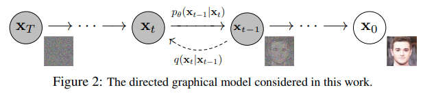

# 🔵 Volet Bleu : Architecture des Modèles de Diffusion, Mémorisation & Déduction Formelle des Attaques (Image)

> **Auteur :** Binôme 1 (Volet Bleu - IA Générative)  
> **Contexte :** Projet de Fin d'Études (PFE) - Cybersécurité & IA (MIA, Extraction & Mémorisation)  
> **Livrable Sprint 2 :** Analyse architecturale et déduction des vulnérabilités avant expérimentations (Sprint 3)

---

## 📑 Table des Matières
1. [Introduction & Contexte](#1-introduction--contexte)
2. [Analyse de l'Architecture DDPM (Le Processus de Débruitage)](#2-analyse-de-larchitecture-ddpm-le-processus-de-débruitage)
3. [Fondements Mathématiques de la Mémorisation Visuelle (Score Matching & Bassins d'Attraction)](#3-fondements-mathématiques-de-la-mémorisation-visuelle-score-matching--bassins-dattraction)
4. [Déduction Formelle des Vecteurs d'Attaque Visuels](#4-déduction-formelle-des-vecteurs-dattaque-visuels)
5. [Sources Académiques Majeures & Dépôts GitHub Officiels](#5-sources-académiques-majeures--dépôts-github-officiels)
6. [Figures et Illustrations Documentées des Papiers Originaux](#6-figures-et-illustrations-documentées-des-papiers-originaux)
7. [Protocole Expérimental Canari pour le Sprint 3 (Le Test Pratique Image)](#7-protocole-expérimental-canari-pour-le-sprint-3-le-test-pratique-image)
8. [Trame de Présentation pour les Slides de Soutenance](#8-trame-de-présentation-pour-les-slides-de-soutenance)

---

## 1. Introduction & Contexte

Après avoir ausculté la génération autorégressive de texte (NanoGPT), nous abordons le second pilier génératif du Volet Bleu : **les modèles de diffusion probabilistes (DDPM - Denoising Diffusion Probabilistic Models)** et les architectures à espace latent (Latent Diffusion / Stable Diffusion).

À l'inverse des modèles autorégressifs qui prédisent un token discret à la fois, les modèles de diffusion opèrent de manière continue sur des espaces continus (pixels ou latents). La question centrale de sécurité est :  
**Comment un processus itératif de débruitage stochastique peut-il en arriver à restituer fidèlement, pixel par pixel, des photographies privées de son jeu d'entraînement ?**

Le modèle d'étude de référence choisi pour comprendre le code est l'implémentation PyTorch minimale et rigoureuse de Phil Wang : **[lucidrains/denoising-diffusion-pytorch](https://github.com/lucidrains/denoising-diffusion-pytorch)**, basée sur l'article fondateur de Ho et al. (NeurIPS 2020).

---

## 2. Analyse de l'Architecture DDPM (Le Processus de Débruitage)

Un modèle de diffusion repose sur deux processus stochastiques conjugués :
1. **Le processus direct (Forward / Noising) :** Ajout analytique progressif de bruit gaussien sans apprentissage.
2. **Le processus inverse (Reverse / Denoising) :** Apprentissage d'un réseau de neurones U-Net paramétré par $\theta$ pour retirer le bruit pas à pas.

<div align="center">
  
</div>

> **Figure 1 : Chaîne de Markov du processus de diffusion (DDPM)**  
> *(Illustration officielle extraite du dépôt de référence [lucidrains/denoising-diffusion-pytorch](https://github.com/lucidrains/denoising-diffusion-pytorch) / Ho et al., NeurIPS 2020)*  
> * **Ligne supérieure (Processus Direct $q$) :** Dégradation progressive de l'image réelle $x_0$ par addition successive de bruit gaussien jusqu'à l'entropie maximale $x_T \sim \mathcal{N}(0, I)$.  
> * **Ligne inférieure (Processus Inverse $p_\theta$) :** Reconstruction générative itérative où le U-Net soustrait l'estimation du bruit $\epsilon_\theta(x_t, t)$ à chaque pas $t$ pour recréer une image nette.

### 2.1. Les Équations du Processus

#### Processus Direct ($q$)
Pour une image d'origine $x_0 \sim q(x)$, on injecte du bruit gaussien selon un ordonnancement de variance (*variance schedule*) $\beta_1, \dots, \beta_T \in (0, 1)$ :
$$q(x_t \mid x_{t-1}) = \mathcal{N}(x_t; \sqrt{1 - \beta_t} x_{t-1}, \beta_t I)$$

Grâce aux propriétés des lois normales, on peut échantillonner directement $x_t$ à n'importe quel pas $t$ sans calculer les étapes intermédiaires. En posant $\alpha_t = 1 - \beta_t$ et $\bar{\alpha}_t = \prod_{s=1}^t \alpha_s$ :
$$q(x_t \mid x_0) = \mathcal{N}(x_t; \sqrt{\bar{\alpha}_t} x_0, (1 - \bar{\alpha}_t) I) \implies x_t = \sqrt{\bar{\alpha}_t} x_0 + \sqrt{1 - \bar{\alpha}_t} \epsilon, \quad \epsilon \sim \mathcal{N}(0, I)$$

Quand $t \to T$ (généralement $T = 1000$), $\bar{\alpha}_T \approx 0$, et $x_T$ devient un bruit gaussien isotrope pur $\mathcal{N}(0, I)$.

#### Processus Inverse ($p_\theta$)
Pour générer une nouvelle image, on part d'un bruit pur $x_T \sim \mathcal{N}(0, I)$ et on remonte le temps $t = T, T-1, \dots, 1$ :
$$p_\theta(x_{t-1} \mid x_t) = \mathcal{N}(x_{t-1}; \mu_\theta(x_t, t), \sigma_t^2 I)$$

Au lieu de prédire directement l'image nettoyée $\mu_\theta$, Ho et al. (2020) ont démontré qu'il est optimal d'entraîner un réseau U-Net $\epsilon_\theta(x_t, t)$ à **prédire le bruit exact $\epsilon$** qui a été injecté dans $x_t$ :
$$\mu_\theta(x_t, t) = \frac{1}{\sqrt{\alpha_t}} \left( x_t - \frac{\beta_t}{\sqrt{1 - \bar{\alpha}_t}} \epsilon_\theta(x_t, t) \right)$$

---

### 2.2. Code Source de la Boucle de Génération (`sample_loop`)
Dans [`denoising_diffusion_pytorch.py`](https://github.com/lucidrains/denoising-diffusion-pytorch/blob/main/denoising_diffusion_pytorch/denoising_diffusion_pytorch.py#L380-L415) :

```python
@torch.no_grad()
def p_sample(self, x, t: int):
    # 1. Prédiction du bruit par le U-Net pour le pas t
    b, *_, device = *x.shape, self.device
    batched_times = torch.full((b,), t, device=device, dtype=torch.long)
    model_mean, _, model_log_variance, _ = self.p_mean_variance(x=x, t=batched_times)
    
    # 2. Ajout de variance stochastique (sauf au dernier pas t = 0)
    noise = torch.randn_like(x) if t > 0 else 0.
    
    # 3. Calcul de x_{t-1}
    pred_img = model_mean + (0.5 * model_log_variance).exp() * noise
    return pred_img

@torch.no_grad()
def sample(self, batch_size=16):
    image_size = self.image_size
    channels = self.channels
    # Initialisation : bruit gaussien pur x_T ~ N(0, I)
    img = torch.randn((batch_size, channels, image_size, image_size), device=self.device)
    
    # Boucle temporelle de débruitage progressif de T à 0
    for t in reversed(range(0, self.num_timesteps)):
        img = self.p_sample(img, t)
        
    # Remise à l'échelle [0, 1]
    img = unnormalize_to_zero_to_one(img)
    return img
```

---

## 3. Fondements Mathématiques de la Mémorisation Visuelle (Score Matching & Bassins d'Attraction)

### 3.1. La Fonction de Perte (Denoising Score Matching)
Durant l'entraînement, le U-Net est optimisé par la perte quadratique moyenne simplifiée (*Ho et al., 2020*) :
$$\mathcal{L}_{\text{simple}}(\theta) = \mathbb{E}_{t \sim [1, T], x_0, \epsilon} \left[ \| \epsilon - \epsilon_\theta\left(\sqrt{\bar{\alpha}_t} x_0 + \sqrt{1 - \bar{\alpha}_t} \epsilon, t\right) \|^2 \right]$$

### 3.2. Le Lien avec le Score Matching et la Théorie de Song et al. (ICLR 2021)
Yang Song et Stefano Ermon ont démontré que prédire le bruit $\epsilon_\theta(x_t, t)$ équivaut rigoureusement à estimer le **vecteur score** (le gradient spatial de la log-densité de probabilité) :
$$\nabla_{x_t} \log p_t(x_t) = - \frac{\epsilon_\theta(x_t, t)}{\sqrt{1 - \bar{\alpha}_t}}$$

À chaque pas de débruitage, le modèle déplace l'état courant $x_t$ le long du gradient de densité pour le ramener vers les zones de haute probabilité.

### 3.3. Comment et Pourquoi la Mémorisation s'installe-t-elle ?
Dans leur publication majeure à USENIX Security 2023 (*« Extracting Training Data from Diffusion Models »*), Nicholas Carlini et son équipe mettent en évidence le mécanisme mathématique de la mémorisation :

1. **Duplication & Sur-apprentissage :** Si une image $x_0$ apparaît plusieurs fois dans le dataset (duplications d'images web, logos récurrents) ou si le modèle est sur-entraîné pendant trop d'époques, le terme d'erreur $\| \epsilon - \epsilon_\theta \|^2$ force le U-Net à sur-ajuster son champ de vecteurs spécifiquement autour de $x_0$.
2. **Création d'un Bassin d'Attraction Anormalement Large :** Au lieu d'apprendre un manifold lisse et continu d'images possibles, le modèle creuse un **puits de potentiel profond**. 
3. **Effondrement des Trajectoires :** Une multitude de bruits initiaux $x_T^{(1)}, x_T^{(2)}, x_T^{(3)}$ complètement indépendants sont capturés par le même cône d'attraction et convergent tous vers la même image exacte $x_0$.

<div align="center">
<svg width="740" height="210" xmlns="http://www.w3.org/2000/svg" style="background:#f8fafc; border:1px solid #cbd5e1; border-radius:8px;">
  <!-- Titre -->
  <text x="370" y="24" fill="#0f172a" font-family="sans-serif" font-size="12" font-weight="bold" text-anchor="middle">Effet du Sur-apprentissage : Création de Bassins d'Attraction Mémorisés</text>

  <!-- Points de départ gaussiens aléatoires -->
  <circle cx="80" cy="60" r="7" fill="#64748b"/>
  <text x="80" y="80" fill="#475569" font-family="sans-serif" font-size="9" text-anchor="middle">Bruit x_T⁽¹⁾</text>

  <circle cx="80" cy="115" r="7" fill="#64748b"/>
  <text x="80" y="135" fill="#475569" font-family="sans-serif" font-size="9" text-anchor="middle">Bruit x_T⁽²⁾</text>

  <circle cx="80" cy="170" r="7" fill="#64748b"/>
  <text x="80" y="190" fill="#475569" font-family="sans-serif" font-size="9" text-anchor="middle">Bruit x_T⁽³⁾</text>

  <!-- Trajectoires de débruitage convergeant -->
  <path d="M 90 60 Q 250 80 440 115" fill="none" stroke="#2563eb" stroke-width="2" stroke-dasharray="3,3"/>
  <path d="M 90 115 L 440 115" fill="none" stroke="#2563eb" stroke-width="2" stroke-dasharray="3,3"/>
  <path d="M 90 170 Q 250 150 440 115" fill="none" stroke="#2563eb" stroke-width="2" stroke-dasharray="3,3"/>

  <!-- Bassin d attraction -->
  <ellipse cx="520" cy="115" rx="90" ry="60" fill="#fee2e2" stroke="#ef4444" stroke-width="2"/>
  <text x="520" y="100" fill="#991b1b" font-family="sans-serif" font-size="11" font-weight="bold" text-anchor="middle">Bassin d'Attraction</text>
  <text x="520" y="115" fill="#b91c1c" font-family="sans-serif" font-size="9" text-anchor="middle">Score ∇ log p(x) forcé</text>

  <circle cx="560" cy="115" r="9" fill="#dc2626"/>
  <text x="560" y="140" fill="#7f1d1d" font-family="sans-serif" font-size="10" font-weight="bold" text-anchor="middle">Image Réelle x₀*</text>
  <text x="560" y="152" fill="#7f1d1d" font-family="sans-serif" font-size="9" text-anchor="middle">(Verbatim Memorized)</text>

  <!-- Légende explicative -->
  <text x="260" y="100" fill="#1d4ed8" font-family="sans-serif" font-size="10" font-style="italic">Champs de vecteurs ε_θ</text>
  <text x="260" y="115" fill="#1d4ed8" font-family="sans-serif" font-size="10" font-style="italic">aspirant les trajectoires</text>
</svg>
</div>

---

## 4. Déduction Formelle des Vecteurs d'Attaque Visuels

En examinant le mécanisme des bassins d'attraction et la fonction de perte $\mathcal{L}_{\text{simple}}$, nous déduisons **trois attaques majeures** adaptées aux modèles de diffusion :

### 4.1. Attaque 1 : Extraction Aveugle par Détection de Cliques Multi-Graines (Carlini et al., USENIX 2023)
*   **Intuition fondamentale :** Dans un espace à haute dimension (ex: $64 \times 64 \times 3 = 12\,288$ dimensions), la probabilité que deux bruits gaussiens aléatoires indépendants $x_T^{(i)} \neq x_T^{(j)}$ produisent par hasard exactement la même image est **rigoureusement nulle** (inférieure à $10^{-100}$).
*   **Protocole d'attaque :**
    1. L'attaquant génère $M$ images (ex: $M = 5\,000$ ou $50\,000$) à partir de graines de bruit aléatoires distinctes.
    2. Pour chaque paire d'images $(\hat{x}_i, \hat{x}_j)$, on calcule la distance euclidienne ou la métrique structurelle :
       $$d(\hat{x}_i, \hat{x}_j) = \frac{1}{C \cdot H \cdot W} \| \hat{x}_i - \hat{x}_j \|_2^2$$
    3. **Détection de cliques :** Si $d(\hat{x}_i, \hat{x}_j) < \delta$ (seuil critique de réplication), cela prouve mathématiquement que les deux bruits sont tombés dans le même bassin d'attraction artificiel.
    4. **Résultat :** L'image commune identifiée est extraite et correspond mot pour mot (*pixel pour pixel*) à une image du jeu d'entraînement.

<div align="center">
<svg width="740" height="210" xmlns="http://www.w3.org/2000/svg" style="background:#f8fafc; border:1px solid #cbd5e1; border-radius:8px;">
  <!-- Étape 1 -->
  <rect x="20" y="35" width="140" height="130" rx="6" fill="#f1f5f9" stroke="#94a3b8" stroke-width="1.5"/>
  <text x="90" y="58" fill="#0f172a" font-family="sans-serif" font-size="11" font-weight="bold" text-anchor="middle">Étape 1 : Échantillonnage</text>
  <text x="90" y="78" fill="#334155" font-family="sans-serif" font-size="9" text-anchor="middle">M graines aléatoires</text>
  <text x="90" y="93" fill="#334155" font-family="sans-serif" font-size="9" text-anchor="middle">x_T⁽¹⁾, ..., x_T⁽ᴹ⁾ ~ N(0,I)</text>
  <text x="90" y="125" fill="#2563eb" font-family="sans-serif" font-size="11" font-weight="bold" text-anchor="middle">Génération M images</text>

  <line x1="160" y1="100" x2="190" y2="100" stroke="#64748b" stroke-width="2"/>

  <!-- Étape 2 -->
  <rect x="190" y="35" width="160" height="130" rx="6" fill="#f1f5f9" stroke="#94a3b8" stroke-width="1.5"/>
  <text x="270" y="58" fill="#0f172a" font-family="sans-serif" font-size="11" font-weight="bold" text-anchor="middle">Étape 2 : Matrice Pairwise</text>
  <text x="270" y="78" fill="#334155" font-family="sans-serif" font-size="9" text-anchor="middle">Calcul distance par paires</text>
  <text x="270" y="95" fill="#475569" font-family="sans-serif" font-size="9" text-anchor="middle">d(x̂ᵢ, x̂ⱼ) via L2 ou SSIM</text>
  <text x="270" y="125" fill="#0284c7" font-family="sans-serif" font-size="10" font-weight="bold" text-anchor="middle">Comparaison O(M²)</text>

  <line x1="350" y1="100" x2="380" y2="100" stroke="#64748b" stroke-width="2"/>

  <!-- Étape 3 -->
  <rect x="380" y="35" width="160" height="130" rx="6" fill="#f1f5f9" stroke="#94a3b8" stroke-width="1.5"/>
  <text x="460" y="58" fill="#0f172a" font-family="sans-serif" font-size="11" font-weight="bold" text-anchor="middle">Étape 3 : Graphe & Cliques</text>
  <text x="460" y="78" fill="#334155" font-family="sans-serif" font-size="9" text-anchor="middle">Connexion si d(x̂ᵢ, x̂ⱼ) &lt; δ</text>
  <text x="460" y="95" fill="#334155" font-family="sans-serif" font-size="9" text-anchor="middle">Regroupement en clusters</text>
  <text x="460" y="125" fill="#d97706" font-family="sans-serif" font-size="10" font-weight="bold" text-anchor="middle">Isolement des doublons</text>

  <line x1="540" y1="100" x2="570" y2="100" stroke="#64748b" stroke-width="2"/>

  <!-- Étape 4 -->
  <rect x="570" y="35" width="150" height="130" rx="6" fill="#fef2f2" stroke="#ef4444" stroke-width="1.5"/>
  <text x="645" y="58" fill="#991b1b" font-family="sans-serif" font-size="11" font-weight="bold" text-anchor="middle">Étape 4 : Extraction</text>
  <text x="645" y="78" fill="#7f1d1d" font-family="sans-serif" font-size="9" text-anchor="middle">Confirmation verbatim</text>
  <text x="645" y="95" fill="#7f1d1d" font-family="sans-serif" font-size="9" text-anchor="middle">Image du training set</text>
  <text x="645" y="125" fill="#dc2626" font-family="sans-serif" font-size="11" font-weight="bold" text-anchor="middle">Photos & secrets volés</text>
</svg>
</div>

---

### 4.2. Attaque 2 : Inférence d'Appartenance (MIA via Erreur de Débruitage)
*   **Objectif :** Étant donné une image candidate $x_0$, déterminer si elle a été utilisée pour entraîner le modèle ($x_0 \in \mathcal{D}_{\text{train}}$).
*   **Mécanisme :**
    1. L'attaquant choisit un pas de temps intermédiaire représentatif $t \in [100, 500]$.
    2. Il applique le bruit analytique forward avec un bruit connu $\epsilon \sim \mathcal{N}(0, I)$ :
       $$x_t = \sqrt{\bar{\alpha}_t} x_0 + \sqrt{1 - \bar{\alpha}_t} \epsilon$$
    3. Il interroge le U-Net pour prédire le bruit $\hat{\epsilon} = \epsilon_\theta(x_t, t)$ et calcule l'erreur résiduelle quadratique :
       $$\mathcal{E}_t(x_0) = \| \epsilon - \epsilon_\theta(x_t, t) \|_2^2$$
    4. **Critère de décision :**
       $$\mathcal{M}(x_0) = \begin{cases} 1 \text{ (Membre)} & \text{si } \mathcal{E}_t(x_0) \le \tau_t \\ 0 \text{ (Non-membre)} & \text{sinon} \end{cases}$$
       *Car le modèle a minimisé la perte spécifiquement sur ses exemples d'entraînement, donc $\mathcal{E}_t(x_0^{\text{train}}) \ll \mathcal{E}_t(x_0^{\text{test}})$.*

---

### 4.3. Attaque 3 : Extraction Conditionnelle par Sur-Guidage (Text-to-Image / Classifier-Free Guidance)
*   **Contexte :** Dans les modèles conditionnés par le texte (Stable Diffusion), la prédiction du bruit est amplifiée par le facteur de guidage $w$ (*Classifier-Free Guidance*) :
    $$\tilde{\epsilon}_\theta(x_t, t, c) = \epsilon_\theta(x_t, t, \emptyset) + w \cdot (\epsilon_\theta(x_t, t, c) - \epsilon_\theta(x_t, t, \emptyset))$$
*   **Vulnérabilité offensive :** En poussant artificiellement $w$ à des valeurs très élevées ($w = 15$ ou $20$), l'attaquant force le processus de débruitage à ignorer la diversité stochastique et à s'effondrer directement sur le mode le plus étroit associé au prompt $c$. Si le prompt correspond à un nom ou une légende présente dans le dataset, l'image d'entraînement originale est restituée sans altération.

---

## 5. Sources Académiques Majeures & Dépôts GitHub Officiels

Voici les articles scientifiques de premier rang et les dépôts de code de référence pour le volet diffusion :

| Domaine / Objet | Référence Académique | Lien ArXiv / Publication | Dépôt GitHub Officiel |
| :--- | :--- | :--- | :--- |
| **Architecture DDPM** | Ho et al. (NeurIPS 2020) *« Denoising Diffusion Probabilistic Models »* | [arXiv:2006.11239](https://arxiv.org/abs/2006.11239) | [lucidrains/denoising-diffusion-pytorch](https://github.com/lucidrains/denoising-diffusion-pytorch) |
| **Extraction sur Diffusion** | Carlini et al. (USENIX Security 2023) *« Extracting Training Data from Diffusion Models »* | [arXiv:2301.13188](https://arxiv.org/abs/2301.13188) | [ryanwebster90/onestep-extraction](https://github.com/ryanwebster90/onestep-extraction) |
| **Réplication Visuelle (DCR)** | Somepalli et al. (CVPR 2023) *« Diffusion Art or Digital Forgery? Investigating Data Replication »* | [arXiv:2212.03860](https://arxiv.org/abs/2212.03860) | [somepago/DCR](https://github.com/somepago/DCR) |
| **Score-Based Generative SDE** | Song et al. (ICLR 2021) *« Score-Based Generative Modeling through Stochastic Differential Equations »* | [arXiv:2011.13456](https://arxiv.org/abs/2011.13456) | [yang-song/score_sde_pytorch](https://github.com/yang-song/score_sde_pytorch) |
| **MIA sur Diffusion** | Duan et al. (ACM CCS 2023) *« Are Diffusion Models Vulnerable to Membership Inference Attacks? »* | [arXiv:2302.01316](https://arxiv.org/abs/2302.01316) | [Duan-Group/diffusion-mia](https://arxiv.org/abs/2302.01316) |
| **Framework Diffusers** | von Platen et al. (HuggingFace 2022) *« Diffusers: State-of-the-art diffusion models »* | Documentation Diffusers | [huggingface/diffusers](https://github.com/huggingface/diffusers) |

---

## 6. Figures et Illustrations Documentées des Papiers Originaux

Pour appuyer la présentation auprès des encadrants, voici les figures incontournables des publications à projeter :

1. **Figure 1 de Carlini et al. (USENIX Security 2023) :**
   * *Description :* Montre des paires d'images côte à côte : à gauche l'image extraite générée par Stable Diffusion, à droite l'image réelle présente dans la base d'entraînement LAION-5B (portraits de personnes réelles, photos de produits, etc.).
   * *Lien direct :* [Page 2 du papier USENIX 2023](https://arxiv.org/pdf/2301.13188.pdf#page=2).

2. **Figure 2 & Graphique de Mémorisation de Carlini et al. (USENIX Security 2023) :**
   * *Description :* Analyse quantitative prouvant que le taux de mémorisation verbatim explose dès qu'une image est dupliquée plus de 10 fois dans le corpus d'entraînement.
   * *Lien direct :* [Page 6 du papier USENIX 2023](https://arxiv.org/pdf/2301.13188.pdf#page=6).

3. **Figure 3 de Somepalli et al. (CVPR 2023) — Le phénomène du « Digital Forgery » :**
   * *Description :* Met en évidence la copie directe de premier plan (*content replication*) par rapport au fond, démontrant que les modèles de diffusion ne composent pas de nouvelles scènes mais collent des éléments entiers du dataset d'entraînement.
   * *Lien direct :* [Page 4 du papier CVPR 2023](https://arxiv.org/pdf/2212.03860.pdf#page=4).

---

## 7. Protocole Expérimental Canari pour le Sprint 3 (Le Test Pratique Image)

Voici le protocole d'expérimentation prêt à l'emploi pour la semaine prochaine sur les images :

1. **Jeu de données & Résolution :**
   * Dataset de base : CIFAR-10 ou Fashion-MNIST (images $32 \times 32$, facile et rapide à entraîner sur machine locale/Google Colab).
2. **Conception des Canaris Visuels :**
   * Génération de 3 images synthétiques atypiques (ex: motif géométrique à haute fréquence, QR code ou croix multicolore distinctive) :
     * `CANARY_IMG_A` : inséré **1 fois** dans le train set.
     * `CANARY_IMG_B` : inséré **10 fois** dans le train set.
     * `CANARY_IMG_C` : inséré **50 fois** dans le train set.
3. **Entraînement & Checkpoints :**
   * Checkpoint 1 : **10 époques** (Apprentissage initial, bruit encore visible).
   * Checkpoint 2 : **50 époques** (Modèle équilibré).
   * Checkpoint 3 : **150 époques** (Sur-entraînement marqué / Overfitting).
4. **Protocole d'Extraction :**
   * Tirer 500 graines de bruit gaussien aléatoire $x_T \sim \mathcal{N}(0, I)$ pour chaque checkpoint.
   * Exécuter la boucle de débruitage complète (`sample()`).
   * Calculer la matrice de similarité structurelle (SSIM) entre les images générées et le canari `CANARY_IMG_C`.
   * Vérifier à quelle époque le canari visuel émerge de manière autonome à partir de bruits aléatoires non guidés.

---

## 8. Trame de Présentation pour les Slides de Soutenance

Pour structurer la partie « Image » de vos slides (Volet Bleu) :

* **Slide 1 - Introduction à la Diffusion :** Le paradigme Forward (ajout de bruit) vs Reverse (débruitage U-Net).
* **Slide 2 - Le Cœur Mathématique :** Denoising Score Matching et estimation du gradient $\nabla \log p(x)$.
* **Slide 3 - La Faille des Bassins d'Attraction :** Comment la duplication et le sur-entraînement créent des puits d'attraction qui capturent les trajectoires stochastiques.
* **Slide 4 - L'Attaque par Détection de Cliques (Carlini 2023) :** Principe de l'attaque boîte noire exploitant la collision de bruits aléatoires.
* **Slide 5 - Inférence d'Appartenance (MIA) :** Comparaison de l'erreur de résidu de bruit $\mathcal{E}_t$ entre membres et non-membres.
* **Slide 6 - Feuille de Route Sprint 3 :** Protocole d'injection de canaris visuels sur CIFAR-10.
