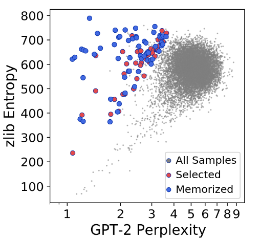

# 🔵 Volet Bleu : Architecture de NanoGPT, Mémorisation & Déduction Formelle des Attaques

> **Auteur :** Binôme 1 (Volet Bleu - IA Générative)  
> **Contexte :** Projet de Fin d'Études (PFE) - Cybersécurité & IA (MIA, Extraction & Mémorisation)  
> **Livrable Sprint 2 :** Analyse architecturale et déduction des vulnérabilités avant expérimentations (Sprint 3)

---

## 📑 Table des Matières
1. [Introduction & Contexte](#1-introduction--contexte)
2. [Analyse de l'Architecture NanoGPT (Le Moteur Autorégressif)](#2-analyse-de-larchitecture-nanogpt-le-moteur-autorégressif)
3. [Fondements Mathématiques de la Mémorisation (Loss & Longue Traîne)](#3-fondements-mathématiques-de-la-mémorisation-loss--longue-traîne)
4. [Déduction Formelle des Vecteurs d'Attaque](#4-déduction-formelle-des-vecteurs-dattaque)
5. [Sources Académiques Majeures & Dépôts GitHub Officiels](#5-sources-académiques-majeures--dépôts-github-officiels)
6. [Figures et Illustrations Documentées des Papiers Originaux](#6-figures-et-illustrations-documentées-des-papiers-originaux)
7. [Protocole Expérimental Canari pour le Sprint 3](#7-protocole-expérimental-canari-pour-le-sprint-3)
8. [Trame de Présentation pour les Slides de Soutenance](#8-trame-de-présentation-pour-les-slides-de-soutenance)

---

## 1. Introduction & Contexte

Dans le cadre de l'évaluation de la confidentialité des modèles d'IA générative, nous concentrons nos efforts sur les modèles de langage de type Transformer causal (*decoder-only*). 

Avant d'exécuter aveuglément des attaques en semaine 3, l'objectif de cette étude est d'**ausculter le code source**, d'identifier les équations qui régissent la génération de texte et d'en **déduire logiquement** comment les données sensibles de la base d'apprentissage se retrouvent mémorisées dans les poids et restituables par un attaquant.

Le modèle d'étude choisi est **[nanoGPT](https://github.com/karpathy/nanoGPT)** d'Andrej Karpathy, implémentation de référence minimaliste, propre et rigoureuse de l'architecture GPT-2.

---

## 2. Analyse de l'Architecture NanoGPT (Le Moteur Autorégressif)

NanoGPT modélise la distribution de probabilité conjointe d'une séquence textuelle $X = (x_1, x_2, \dots, x_N)$ par factorisation autorégressive :
$$P(X) = \prod_{t=1}^N P(x_t \mid x_1, x_2, \dots, x_{t-1})$$

### 2.1. Code Source de la Boucle de Génération
Dans le fichier source [`model.py` (méthode `generate`)](https://github.com/karpathy/nanoGPT/blob/master/model.py#L283-L309) :

```python
@torch.no_grad()
def generate(self, idx, max_new_tokens, temperature=1.0, top_k=None):
    """
    Prend un tenseur conditionnant idx de dimension (B, T) et génère max_new_tokens
    en boucle de manière autorégressive.
    """
    for _ in range(max_new_tokens):
        # 1. Fenêtrage contextuel (ne pas dépasser block_size)
        idx_cond = idx if idx.size(1) <= self.config.block_size else idx[:, -self.config.block_size:]
        
        # 2. Forward pass : calcul des logits pour toutes les positions
        logits, _ = self(idx_cond)
        
        # 3. Extraction du vecteur logit du DERNIER token prédit
        logits = logits[:, -1, :] / temperature
        
        # 4. Tronquage optionnel des queues de distribution (Top-k)
        if top_k is not None:
            v, _ = torch.topk(logits, min(top_k, logits.size(-1)))
            logits[logits < v[:, [-1]]] = -float("Inf")
            
        # 5. Normalisation en distribution catégorielle via Softmax
        probs = F.softmax(logits, dim=-1)
        
        # 6. Échantillonnage stochastique ou greedy du token suivant
        idx_next = torch.multinomial(probs, num_samples=1)
        
        # 7. Concaténation récursive pour alimenter l'étape t + 1
        idx = torch.cat((idx, idx_next), dim=1)

    return idx
```

### 2.2. Schéma Vectoriel du Pipeline Autorégressif

<div align="center">
<svg width="740" height="210" xmlns="http://www.w3.org/2000/svg" style="background:#f8fafc; border:1px solid #cbd5e1; border-radius:8px;">
  <!-- Blocs -->
  <rect x="20" y="75" width="105" height="55" rx="6" fill="#1e293b"/>
  <text x="72" y="98" fill="#f8fafc" font-family="sans-serif" font-size="11" font-weight="bold" text-anchor="middle">Prompt / Contexte</text>
  <text x="72" y="116" fill="#94a3b8" font-family="sans-serif" font-size="10" text-anchor="middle">Tokens x₁:ₜ</text>

  <line x1="125" y1="102" x2="160" y2="102" stroke="#64748b" stroke-width="2" marker-end="url(#arr)"/>

  <rect x="160" y="75" width="125" height="55" rx="6" fill="#2563eb"/>
  <text x="222" y="98" fill="#ffffff" font-family="sans-serif" font-size="11" font-weight="bold" text-anchor="middle">Transformer Blocks</text>
  <text x="222" y="116" fill="#bfdbfe" font-family="sans-serif" font-size="10" text-anchor="middle">Attention Causale + MLP</text>

  <line x1="285" y1="102" x2="320" y2="102" stroke="#64748b" stroke-width="2"/>

  <rect x="320" y="75" width="105" height="55" rx="6" fill="#0284c7"/>
  <text x="372" y="98" fill="#ffffff" font-family="sans-serif" font-size="11" font-weight="bold" text-anchor="middle">Tête Linéaire</text>
  <text x="372" y="116" fill="#bae6fd" font-family="sans-serif" font-size="10" text-anchor="middle">Logits z ∈ ℝ|V|</text>

  <line x1="425" y1="102" x2="460" y2="102" stroke="#64748b" stroke-width="2"/>

  <rect x="460" y="75" width="115" height="55" rx="6" fill="#0d9488"/>
  <text x="517" y="98" fill="#ffffff" font-family="sans-serif" font-size="11" font-weight="bold" text-anchor="middle">Softmax / Temp</text>
  <text x="517" y="116" fill="#ccfbf1" font-family="sans-serif" font-size="10" text-anchor="middle">Probabilité P(xₜ₊₁)</text>

  <line x1="575" y1="102" x2="610" y2="102" stroke="#64748b" stroke-width="2"/>

  <rect x="610" y="75" width="105" height="55" rx="6" fill="#16a34a"/>
  <text x="662" y="98" fill="#ffffff" font-family="sans-serif" font-size="11" font-weight="bold" text-anchor="middle">Échantillonnage</text>
  <text x="662" y="116" fill="#bbf7d0" font-family="sans-serif" font-size="10" text-anchor="middle">Nouveau Token xₜ₊₁</text>

  <!-- Boucle de feedback autorégressive -->
  <path d="M 662 75 L 662 30 L 72 30 L 72 75" fill="none" stroke="#dc2626" stroke-width="2" stroke-dasharray="5,5"/>
  <text x="365" y="24" fill="#dc2626" font-family="sans-serif" font-size="10" font-weight="bold" text-anchor="middle">Boucle Récursive Autorégressive (idx = torch.cat([idx, idx_next]))</text>
</svg>
</div>

---

## 3. Fondements Mathématiques de la Mémorisation (Loss & Longue Traîne)

### 3.1. La Fonction de Perte (Cross-Entropy Loss)
Durant l'entraînement ([`train.py`](https://github.com/karpathy/nanoGPT/blob/master/train.py)), les poids $\theta$ sont mis à jour par descente de gradient pour minimiser l'entropie croisée :
$$\mathcal{L}_{CE}(\theta) = - \frac{1}{T} \sum_{t=1}^T \log P_\theta(x_t \mid x_{<t}) = - \frac{1}{T} \sum_{t=1}^T \log \left( \frac{\exp(z_{x_t} / T_{train})}{\sum_{w \in V} \exp(z_w / T_{train})} \right)$$

Pour qu'une séquence particulière $(x_1, \dots, x_T)$ atteigne une perte quasi nulle ($\mathcal{L}_{CE} \to 0$), il faut :
$$P_\theta(x_t \mid x_{<t}) \to 1 \implies z_{x_t} \gg \max_{w \neq x_t} z_w$$
Le réseau sur-dimensionné ajuste alors ses matrices d'attention et ses couches MLP pour créer un chemin déterministe où le logit de la cible écrase tous les autres.

### 3.2. La Théorie de la Longue Traîne (Feldman, STOC 2020)
Dans son article séminal *« Does Learning Require Memorization? A Short Tale about a Long Tail »* ([Feldman, STOC 2020](https://arxiv.org/abs/1906.05271)), Vitaly Feldman démontre mathématiquement que :
1. Les distributions de données naturelles (texte, code) suivent des lois de puissance (lois de Zipf). Une proportion massive d'exemples se situe dans la **longue traîne** (fréquence d'apparition rare ou unique).
2. Pour atteindre une performance optimale sur le test set, un modèle **doit nécessairement mémoriser** ces exemples rares verbatim, car aucune règle statistique générale ne permet de les déduire.
3. Le sur-entraînement (overtraining sur 50, 100, 200 époques) transforme ce compromis en **hyper-mémorisation** irréversible.

<div align="center">
<svg width="740" height="200" xmlns="http://www.w3.org/2000/svg" style="background:#f8fafc; border:1px solid #cbd5e1; border-radius:8px;">
  <!-- Axes -->
  <line x1="50" y1="160" x2="700" y2="160" stroke="#475569" stroke-width="2"/>
  <line x1="50" y1="160" x2="50" y2="25" stroke="#475569" stroke-width="2"/>
  <text x="690" y="180" fill="#475569" font-family="sans-serif" font-size="11" text-anchor="end">Rareté des séquences (Sous-populations)</text>
  <text x="35" y="25" fill="#475569" font-family="sans-serif" font-size="11" text-anchor="middle" transform="rotate(-90 35,25)">Fréquence</text>

  <!-- Courbe Zipf -->
  <path d="M 50 40 Q 110 50 170 115 T 400 152 T 700 158" fill="none" stroke="#2563eb" stroke-width="3"/>

  <!-- Zone Généralisation -->
  <rect x="55" y="45" width="130" height="110" fill="#3b82f6" fill-opacity="0.15" rx="4"/>
  <text x="120" y="80" fill="#1d4ed8" font-family="sans-serif" font-size="11" font-weight="bold" text-anchor="middle">Généralisation</text>
  <text x="120" y="98" fill="#1e40af" font-family="sans-serif" font-size="9" text-anchor="middle">Grammaire, syntaxe,</text>
  <text x="120" y="112" fill="#1e40af" font-family="sans-serif" font-size="9" text-anchor="middle">mots fréquents</text>

  <!-- Zone Mémorisation (Longue Traîne) -->
  <rect x="230" y="120" width="460" height="38" fill="#ef4444" fill-opacity="0.15" rx="4"/>
  <text x="460" y="137" fill="#b91c1c" font-family="sans-serif" font-size="11" font-weight="bold" text-anchor="middle">Mémorisation Forcée (La Longue Traîne - Feldman 2020)</text>
  <text x="460" y="151" fill="#7f1d1d" font-family="sans-serif" font-size="9" text-anchor="middle">Données uniques, canaris, secrets, PII, verbatim memorization</text>
</svg>
</div>

---

## 4. Déduction Formelle des Vecteurs d'Attaque

En analysant la boucle `generate()` et l'équation de Cross-Entropy, nous déduisons trois attaques formelles :

### 4.1. Attaque 1 : Extraction Ciblée par Préfixe (Prefix-Prompting)
*   **Mécanisme :** L'attaquant fournit un préfixe $p = (x_1, \dots, x_k)$ connu ou supposé (ex: `"L'employé n°441 est : "`).
*   **Fondement logique :** Si la suite $s = (x_{k+1}, \dots, x_{k+m})$ a été mémorisée, l'attention causale focalise 100% des poids sur le suffixe exact. Même en échantillonnage aléatoire (`temperature=1.0`), $P(x_{k+1} \mid p) \approx 1.0$.
*   **Conséquence :** L'attaquant récupère le secret sans bruit en quelques millisecondes.

### 4.2. Attaque 2 : Extraction Aveugle & Filtrage par Perplexité (Carlini et al., USENIX 2021)
*   **Problème initial :** Comment extraire des données sensibles si l'attaquant ne connaît aucun préfixe initial ?
*   **Principe de l'attaque :**
    1. L'attaquant génère un volume massif de textes ($M = 200\,000$ séquences) à partir de prompts vides ou de courts préfixes aléatoires.
    2. **Le défi du tri :** Comment distinguer une phrase mémorisée du corpus d'une simple hallucination cohérente du modèle ?
    3. **Le workflow officiel en deux phases (Attaque & Évaluation) :**

<div align="center">
  
</div>

> **Figure 2 du papier original (Carlini et al., USENIX Security 2021) :** *Workflow of our extraction attack and evaluation.*  
> * **1) Attaque :** Génération de 200 000 échantillons à partir de GPT-2 conditionné sur des préfixes (potentiellement vides). Tri de chaque génération selon 6 métriques de détection et déduplication pour isoler les séquences candidates.  
> * **2) Évaluation :** Inspection manuelle de 100 parmi les 1 000 meilleures générations par métrique. Validation du caractère mémorisé par recherche web et confrontation avec la base d'entraînement OpenAI.  
> *Dépôt officiel du code :* [ftramer/LM_Memorization](https://github.com/ftramer/LM_Memorization)

---

#### Le rôle clé des Métriques de Filtrage (Pourquoi PPL seule échoue)
Le calcul de la perplexité brute $\text{PPL}(x)$ favorise artificiellement les séquences répétitives ou triviales (comme `"1 1 1 1 1"` ou `"the the the"`). Pour éliminer ces faux positifs, Carlini et al. comparent la perplexité cible à une mesure de complexité intrinsèque du texte :

$$\text{Metric 1} = \frac{\text{PPL}_{\text{Target}}(x)}{\text{PPL}_{\text{Reference}}(x)} \qquad \text{Metric 2} = \frac{\text{PPL}_{\text{Target}}(x)}{\text{Compression}_{\text{zlib}}(x)}$$

Une séquence mémorisée du corpus présente une signature unique : une perplexité exceptionnellement basse sur le modèle cible **mais** une entropie de compression standard (zlib) ou une perplexité normale sur un autre modèle.

<div align="center">
  
</div>

> **Figure 3 du papier original (Carlini et al., USENIX Security 2021) :** *The zlib entropy and the perplexity of GPT-2 XL for 200,000 samples generated with top-n sampling.*  
> * **Nuage de points global (200 000 échantillons) :** Répartition de l'entropie zlib en abscisse et de la perplexité GPT-2 XL en ordonnée.  
> * **Points rouges (Top-100) :** Les 100 échantillons sélectionnés par le ratio Perplexité / zlib pour inspection manuelle.  
> * **Points bleus (59 confirmés) :** Les 59 échantillons confirmés avec certitude comme des extraits mémorisés mot pour mot (*verbatim*) du corpus d'entraînement WebText.  
> * **Conclusion empirique :** Le ratio isole nettement les secrets réels (amas en bas à droite : haute complexité linguistique zlib, mais perplexité anormale pour le modèle qui l'a appris par cœur).

---

### 4.3. Attaque 3 : Inférence d'Appartenance (MIA - Loss Thresholding)
*   **Objectif :** Déterminer si une séquence candidate $x$ a fait partie de la base d'entraînement ($\mathcal{D}_{train}$).
*   **Formulation :**
    $$\mathcal{M}(x) = \begin{cases} 1 \text{ (Membre)} & \text{si } \mathcal{L}_{CE}(x; \theta) \le \tau \\ 0 \text{ (Non-membre)} & \text{sinon} \end{cases}$$
    où le seuil $\tau$ est calibré sur un jeu de validation disjoint.

---

## 5. Sources Académiques Majeures & Dépôts GitHub Officiels

Voici les articles scientifiques de premier rang et les dépôts de code de référence pour étayer l'étude et les slides :

| Domaine / Objet | Référence Académique | Lien ArXiv / Publication | Dépôt GitHub Officiel |
| :--- | :--- | :--- | :--- |
| **NanoGPT Architecture** | Karpathy, Andrej (2022) *« nanoGPT: The simplest, fastest repository for training/finetuning medium GPTs »* | Documentation NanoGPT | [karpathy/nanoGPT](https://github.com/karpathy/nanoGPT) |
| **Extraction Attaque LLM** | Carlini et al. (USENIX Security 2021) *« Extracting Training Data from Large Language Models »* | [arXiv:2012.07805](https://arxiv.org/abs/2012.07805) | [ftramer/LM_Memorization](https://github.com/ftramer/LM_Memorization) |
| **Quantification Mémorisation** | Carlini et al. (IEEE S&P 2023) *« Quantifying Memorization Across Neural Language Models »* | [arXiv:2202.07646](https://arxiv.org/abs/2202.07646) | [ethz-spylab/lm_memorization_data](https://github.com/ethz-spylab/lm_memorization_data) |
| **Canaris & Exposure Metric** | Carlini et al. (USENIX Security 2019) *« The Secret Sharer: Evaluating and Testing Unintended Memorization »* | [arXiv:1802.08232](https://arxiv.org/abs/1802.08232) | [google-research/lm-extraction-benchmark](https://github.com/google-research/lm-extraction-benchmark) |
| **Théorie Longue Traîne** | Feldman, Vitaly (STOC 2020) *« Does Learning Require Memorization? A Short Tale about a Long Tail »* | [arXiv:1906.05271](https://arxiv.org/abs/1906.05271) | [vitalyfeldman/long-tail-learning](https://arxiv.org/abs/1906.05271) |
| **MIA & Overfitting** | Yeom et al. (IEEE CSF 2018) *« Privacy Risk in Machine Learning: Analyzing the Connection to Overfitting »* | [arXiv:1709.01604](https://arxiv.org/abs/1709.01604) | [tensorflow/privacy](https://github.com/tensorflow/privacy) |

---

## 6. Figures et Illustrations Documentées des Papiers Originaux

Pour appuyer la présentation auprès des encadrants, voici les figures exactes des articles intégrées et à projeter :

1. **Figure 2 de Carlini et al. (USENIX Security 2021) — Intégrée en Section 4.2 :**
   * *Contenu :* Workflow complet en 2 phases : Génération aveugle & Tri selon 6 métriques $\to$ Évaluation, recherche web et requête OpenAI.
   * *Fichier local :* [`Workflow of our extraction attack and evaluation_carlini.png`](./Workflow%20of%20our%20extraction%20attack%20and%20evaluation_carlini.png)
   * *Lien papier original :* [Page 5 du papier USENIX 2021](https://arxiv.org/pdf/2012.07805.pdf#page=5).

2. **Figure 3 de Carlini et al. (USENIX Security 2021) — Intégrée en Section 4.2 :**
   * *Contenu :* Nuage de points zlib vs Perplexité sur 200 000 échantillons, mettant en évidence les 59 extraits verbatim confirmés.
   * *Fichier local :* [`perplexity_tab_carlini.png`](./perplexity_tab_carlini.png)
   * *Lien papier original :* [Page 6 du papier USENIX 2021](https://arxiv.org/pdf/2012.07805.pdf#page=6).

3. **Figure 3 de Carlini et al. (IEEE S&P 2023) — Lois d'échelle :**
   * *Description :* Établit les « Lois d'échelle de la mémorisation » (*Scaling Laws of Memorization*) : la quantité de données restituables explose de façon super-linéaire avec la taille du modèle et la duplication des données.
   * *Lien direct :* [Page 5 du papier IEEE S&P 2023](https://arxiv.org/pdf/2202.07646.pdf#page=5).

---

## 7. Protocole Expérimental Canari pour le Sprint 3

Ce protocole servira de feuille de route pratique dès le début de la semaine 3 :

1. **Jeu de données de base :** `data/shakespeare_char/input.txt` (1 Mo de texte brut).
2. **Conception des Canaris :** Insertion de chaînes atypiques à haute entropie :
   * `CANARY_TYPE_A = "SECRET_KEY_ALPHA_739281"` (inséré 1 fois)
   * `CANARY_TYPE_B = "SECRET_KEY_BETA_184920"` (inséré 5 fois)
   * `CANARY_TYPE_C = "SECRET_KEY_GAMMA_903817"` (inséré 20 fois)
3. **Entraînement & Checkpoints :**
   * Checkpoint 1 : **20 époques** (Sous-apprentissage / début de convergence)
   * Checkpoint 2 : **100 époques** (Modèle bien calé)
   * Checkpoint 3 : **200 époques** (Sur-apprentissage prononcé / Overfitting)
4. **Métrique d'Évaluation (Exposure de Carlini 2019) :**
   $$\text{Exposure}_\theta(c) = \log_2 |S| - \log_2 \text{rank}_\theta(c)$$
   Mesure la facilité avec laquelle le canari émerge face à des chaînes aléatoires de même format.

---

## 8. Trame de Présentation pour les Slides de Soutenance

Pour structurer le support de présentation (Livrable Sprint 2) :

* **Slide 1 - Titre & Problématique :** Modèles autorégressifs & Fuites de données mémorisées.
* **Slide 2 - Anatomie de NanoGPT :** Présentation du code `generate()`, causal mask et Softmax.
* **Slide 3 - Mécanisme de Mémorisation :** Explication mathématique de la Cross-Entropy et de la théorie de la Longue Traîne (*Feldman 2020*).
* **Slide 4 - Vecteurs d'Attaque Déduits :** Comparaison Prefix-Prompting vs Extraction Aveugle (Carlini 2021).
* **Slide 5 - Métrique de Détection :** Pourquoi le ratio $\text{PPL} / \text{zlib}$ permet de démasquer les secrets mémorisés.
* **Slide 6 - Protocole Pratique Sprint 3 :** Plan de tests d'injection de canaris sur Shakespeare.
